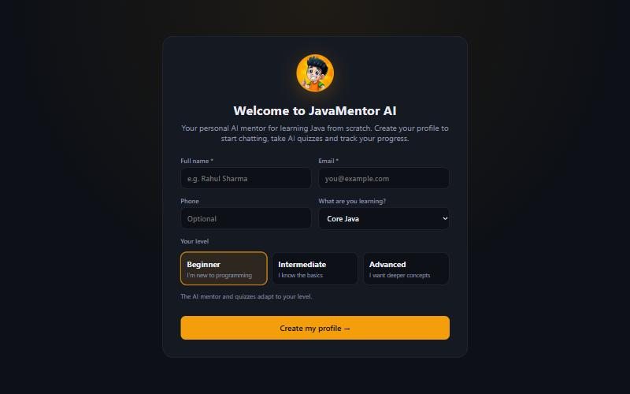
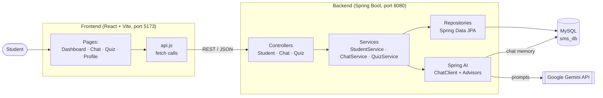
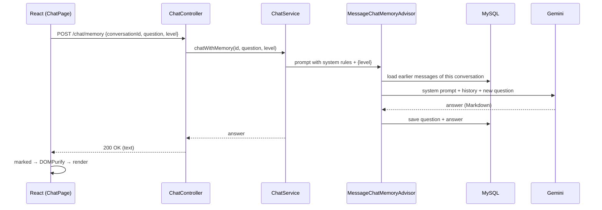
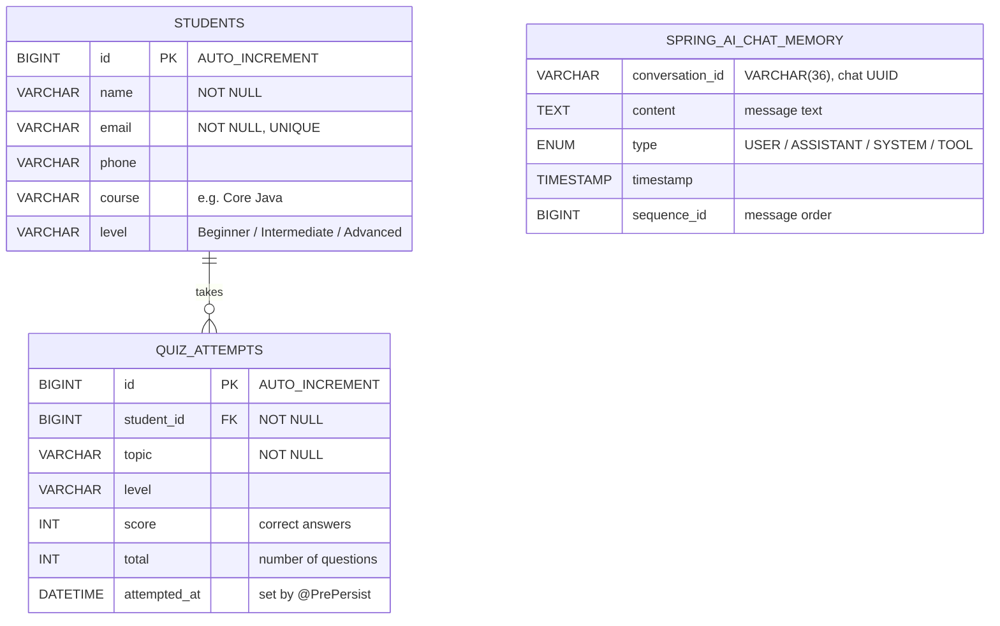

<div align="center">


# JavaMentor AI

**An AI-powered mentor for students learning Java from scratch.**
Chat with a patient AI tutor, practise with AI-generated quizzes, and track your progress on a personal dashboard.


</div>

---

## Table of contents

- [About the project](#about-the-project)
- [Features](#features)
- [Screenshots](#screenshots)
- [Tech stack](#tech-stack)
- [Project architecture](#project-architecture)
- [How the AI works](#how-the-ai-works)
- [Database design](#database-design)
- [REST API](#rest-api)
- [Project structure](#project-structure)
- [Getting started](#getting-started)
- [Testing](#testing)
- [Future implementation](#future-implementation)
- [Known limitations](#known-limitations)

---

## About the project

Beginners learning Java get stuck on small doubts, don't know whether they really understood a topic, and have no idea what to study next.
**JavaMentor AI** solves this with three things in one place:

1. **An AI mentor** that explains concepts step by step, with real-life analogies, commented Java code and a small exercise. It adapts to the student's level.
2. **AI quizzes** on any Java topic, with instant feedback and explanations.
3. **A performance dashboard** that turns quiz results into accuracy, strong and weak topics, and an **AI-generated study plan**.

---

## Features

| Feature | Description |
|---|---|
| 👤 **Student profile** | Create, view, update and delete a profile (name, email, course, level). The level (Beginner / Intermediate / Advanced) personalises the AI |
| 💬 **AI Mentor Chat** | Multi-conversation chat with the Gemini model. Remembers earlier messages (memory stored in MySQL), renders Markdown and code, and has a copy button |
| 📝 **AI Quiz** | Pick from 14 topics or type your own. Choose level and number of questions; the AI writes fresh multiple-choice questions every time |
| ✅ **Instant feedback** | Correct and wrong answers are highlighted, with a short explanation per question and a full answer review at the end |
| 📊 **Performance dashboard** | Quizzes taken, accuracy, best score, questions answered, score trend chart, topic-wise performance (weakest first) |
| 🤖 **AI study plan** | The AI reads your quiz history and returns *Strengths / Needs work / Next steps* |
| 📱 **Responsive UI** | Works on desktop and mobile (collapsible sidebar) |

---

## Screenshots

| Dashboard (performance + AI study plan) | AI Mentor Chat |
|---|---|
|  |  |

| AI Quiz (instant feedback) | My Profile |
|---|---|
|  |  |

| Onboarding (create profile) |
|---|
|  |

---

## Tech stack

| Layer | Technology |
|---|---|
| Language | Java 21 |
| Backend framework | Spring Boot 4.1 (Spring Web MVC) |
| AI | Spring AI 2.0 + Google Gemini (`gemini-3.5-flash-lite`) |
| Persistence | Spring Data JPA (Hibernate), MySQL 8 |
| Chat memory | Spring AI JDBC Chat Memory Repository (MySQL) |
| Frontend | React 18, Vite 5 |
| Markdown / security | marked, DOMPurify (XSS protection) |
| Build tools | Maven, npm |
| API testing | Postman |

---

## Project architecture

The backend follows a **layered architecture**: Controller → Service → Repository → Database.
The React app talks to the backend over REST. During development, Vite proxies `/api` and `/chat` to Spring Boot, so no CORS setup is needed.



| Layer | Responsibility |
|---|---|
| **Controller** | HTTP only: maps URLs, reads the request body and path variables, sets status codes (201, 204) |
| **Service** | Business logic and all Spring AI code (prompts, memory, structured output, validation, retries) |
| **Repository** | Database access through Spring Data JPA; queries are derived from method names |
| **Entity / DTO** | Entities map tables; DTOs and records define request and response shapes (entities are never exposed directly) |

### Request flow: asking the AI mentor a question



---

## How the AI works

| Spring AI concept | Where it is used |
|---|---|
| **`ChatClient`** (fluent API) | All AI calls: `prompt().system().user().call()` |
| **System prompt** | Gives the AI the *JavaMentor* personality: step-by-step teaching, analogies, Java-only code, a "Try it yourself" exercise, staying on topic |
| **Prompt templates** | `{level}`, `{topic}` and `{count}` are filled at runtime, so the same prompt adapts to each student |
| **Chat memory + advisor** | `MessageChatMemoryAdvisor` with a JDBC repository, so each conversation's history is stored in MySQL and sent with follow-up questions |
| **Structured output** | `.entity(Quiz.class)` makes Gemini return JSON that maps straight onto Java records (`Quiz`, `Question`) |
| **Defensive AI handling** | Quiz output is **validated** (exactly 4 options, a valid `correctIndex`) and the call is **retried up to 3 times** if the model returns broken JSON |
| **AI analysis** | The study-plan endpoint turns quiz history into text and asks the model for strengths, weak areas and next steps |

> Official numbers (scores, accuracy, averages) are always **calculated in code**. The AI only explains and advises; it never decides the numbers.

---

## Database design

Database: **`sms_db`** (MySQL). Tables are created automatically: `students` and `quiz_attempts` by Hibernate (`ddl-auto=update`), and `SPRING_AI_CHAT_MEMORY` by Spring AI (`initialize-schema=always`).



| Table | Purpose | Notes |
|---|---|---|
| `students` | Student profiles | `email` is unique. `level` personalises AI answers and quizzes |
| `quiz_attempts` | One row per finished quiz | `@ManyToOne` → `students.id`. Deleting a student first deletes their attempts, both inside one `@Transactional` method |
| `SPRING_AI_CHAT_MEMORY` | Conversation history for the AI | Managed by Spring AI. `conversation_id` = the chat's UUID created in the browser (36 chars). Indexed by `(conversation_id, timestamp)` and `(conversation_id, sequence_id)` |

**Design decisions**
- Percentages are **not stored**; they are calculated from `score / total` when needed, so the data can never contradict itself.
- The API returns **DTO records** (`AttemptResponse`) instead of the `QuizAttempt` entity, which avoids lazy-loading and serialization problems.
- `attempted_at` is set automatically in a `@PrePersist` callback, so clients can't fake the time.

---

## REST API

Base URL: `http://localhost:8080`

### Student profile

| Method | Endpoint | Description | Success |
|---|---|---|---|
| `POST` | `/api/students` | Create a profile | `201 Created` |
| `GET` | `/api/students/{id}` | Get one profile | `200 OK` (`404` if not found) |
| `GET` | `/api/students` | List profiles | `200 OK` |
| `PUT` | `/api/students/{id}` | Update a profile | `200 OK` |
| `DELETE` | `/api/students/{id}` | Delete a profile and its quiz history | `204 No Content` |

```json
// POST /api/students
{ "name": "Rahul Sharma", "email": "rahul@example.com", "phone": "9876543210",
  "course": "Core Java", "level": "Beginner" }
```

### AI Mentor Chat

| Method | Endpoint | Description |
|---|---|---|
| `POST` | `/chat/memory` | Ask the mentor; remembers the conversation. Body: `{ "conversationId": "<uuid>", "question": "...", "level": "Beginner" }`. Returns Markdown text |

### AI Quiz and performance

| Method | Endpoint | Description | Success |
|---|---|---|---|
| `POST` | `/api/quiz/generate` | Generate a quiz. Body: `{ "topic": "Loops", "level": "Beginner", "count": 5 }` | `200 OK` |
| `POST` | `/api/quiz/attempts` | Save a finished quiz. Body: `{ "studentId": 1, "topic": "Loops", "level": "Beginner", "score": 4, "total": 5 }` | `201 Created` |
| `GET` | `/api/quiz/attempts/{studentId}` | Quiz history, newest first (includes `percentage`) | `200 OK` |
| `GET` | `/api/quiz/tips/{studentId}` | AI study plan based on the quiz history (Markdown) | `200 OK` |

```json
// POST /api/quiz/generate  →  response
{
  "topic": "Loops",
  "questions": [
    {
      "question": "What does `for (int i = 0; i < 3; i++)` print if the body is `System.out.print(i);`?",
      "options": ["123", "012", "0123", "Nothing"],
      "correctIndex": 1,
      "explanation": "i starts at 0 and the loop stops before i reaches 3."
    }
  ]
}
```

### Learning endpoints (Spring AI basics)

Kept from the learning phase to show each Spring AI concept on its own:

| Method | Endpoint | Concept |
|---|---|---|
| `GET` | `/chat?question=` | Plain `ChatClient` call |
| `GET` | `/chat/system?question=` | System prompt |
| `GET` | `/chat/template?topic=&level=` | Prompt template |
| `GET` | `/chat/system/template?topic=&level=` | System prompt + template |
| `POST` | `/chat/post` | JSON body with a `Map` |
| `POST` | `/chat/structured` | Structured output → `ConceptExplanation` record |

---

## Project structure

```
java-mentor-ai/
├── pom.xml
├── src/main/java/com/example/javamentor/
│   ├── JavaMentorAiApplication.java      # Spring Boot entry point
│   ├── controller/                       # REST endpoints (HTTP only)
│   │   ├── StudentController.java
│   │   ├── ChatController.java
│   │   └── QuizController.java
│   ├── service/                          # business logic + Spring AI
│   │   ├── StudentService.java
│   │   ├── ChatService.java              # mentor prompt, chat memory
│   │   └── QuizService.java              # quiz generation, validation, retry, study tips
│   ├── repository/                       # Spring Data JPA
│   │   ├── StudentRepository.java
│   │   └── QuizAttemptRepository.java
│   ├── entity/                           # JPA entities
│   │   ├── Student.java
│   │   └── QuizAttempt.java
│   ├── dto/                              # request/response records
│   │   ├── ChatRequest.java
│   │   ├── Quiz.java
│   │   ├── QuizDtos.java
│   │   └── ConceptExplanation.java
│   └── exception/
│       └── StudentNotFoundException.java # → 404
├── src/main/resources/application.properties
├── frontend/                             # React app (Vite)
│   ├── public/logo.png
│   ├── vite.config.js                    # proxies /api and /chat → :8080
│   └── src/
│       ├── App.jsx                       # app shell, page routing (#hash)
│       ├── api.js                        # every backend call lives here
│       ├── hooks/useChats.js             # chat list per student
│       ├── components/                   # Sidebar, Message, Markdown, Logo
│       └── pages/                        # Dashboard, ChatPage, QuizPage, ProfilePage
└── docs/screenshots/
```

---

## Getting started

### Prerequisites

- **JDK 21+**
- **MySQL 8** running on `localhost:3306` (the database `sms_db` is created automatically)
- **Node.js 18+** and npm
- A **Google Gemini API key**, free from [Google AI Studio](https://aistudio.google.com/apikey)

### 1. Configure environment variables

Secrets are **never** stored in the code. Set these before starting the backend (in Eclipse: *Run Configurations → Environment*):

| Variable | Example | Required |
|---|---|---|
| `Gemini_API_KEY` | `your-gemini-key` | ✅ |
| `DB_PASSWORD` | `your-mysql-password` | ✅ |
| `DB_USERNAME` | `root` (default) | optional |

### 2. Run the backend

```bash
./mvnw spring-boot:run
```

On Windows use `mvnw.cmd spring-boot:run`, or in Eclipse: *Run As → Spring Boot App*. The backend starts on **http://localhost:8080**.

### 3. Run the frontend

```bash
cd frontend
npm install
npm run dev
```

Open **http://localhost:5173**, create your profile and start learning.

---

## Testing

All REST endpoints were tested manually with **Postman**, covering success and error cases:

| Scenario | Expected |
|---|---|
| Create a profile | `201 Created` with the generated `id` |
| Get / update a profile | `200 OK` |
| Delete a profile | `204 No Content` (quiz history deleted too) |
| Get a deleted or unknown id | `404 Not Found` |
| Follow-up question in the same conversation | AI remembers the earlier question |
| New `conversationId` | AI starts a fresh conversation |
| Generate a quiz | Valid questions with exactly 4 options |

The full flow (create profile → quiz → dashboard → edit → delete) was also tested end to end in the browser.

---

## Future implementation

| Planned | Why |
|---|---|
| 🔐 **Register and login with Spring Security + JWT** | Each student can access only their own data; replaces the browser-stored profile id |
| 🗂️ **Chats saved per student on the server** | Conversations follow the student to any device (currently the chat list is kept in the browser) |
| ✅ **Validation + global error handling** | `@Valid` DTOs and `@RestControllerAdvice` for clean `400` / `409` responses (e.g. duplicate email) |
| ⚡ **Streaming answers** | Show the AI's answer word by word (`.stream()` + Server-Sent Events) |
| 📚 **RAG (Retrieval-Augmented Generation)** | Upload Java notes or PDFs into a vector store so the mentor answers from course material |
| 🛠️ **Tool calling** | Let the AI call backend methods ("show my weak topics") using real student data |
| 🧪 **Automated tests** | JUnit 5 + MockMvc tests for every endpoint, with the AI mocked |
| 🏅 **Gamification** | Daily streaks, badges and a learning roadmap per level |
| 🐳 **Docker + cloud deployment** | `docker-compose` for app + MySQL; deploy the backend (Render / Railway) and frontend (Vercel) |

---

## Known limitations

- There is **no authentication yet**: the current profile is remembered by its id in the browser's `localStorage`. Login with JWT is the next milestone.
- A duplicate email currently returns `500` instead of `409`; this will be fixed by the global error handler.
- AI answers depend on the Gemini API being available, and the free tier has rate limits.

---

<div align="center">

Built with ☕ Java, 🌱 Spring AI and ⚛️ React

</div>
