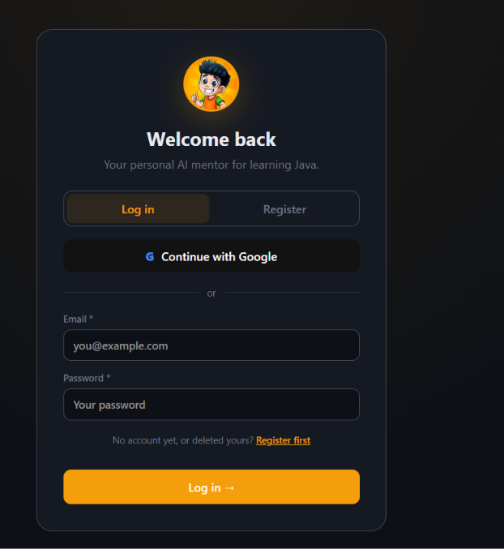
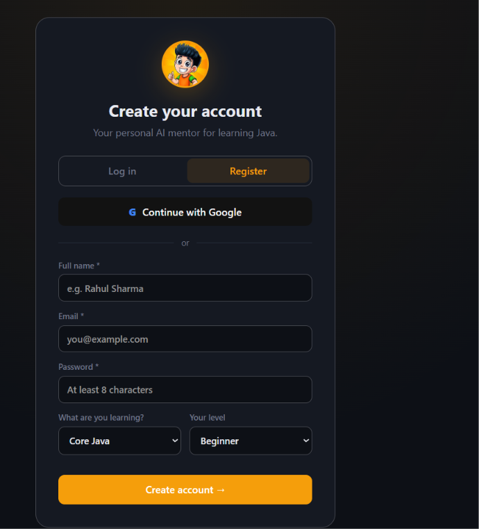
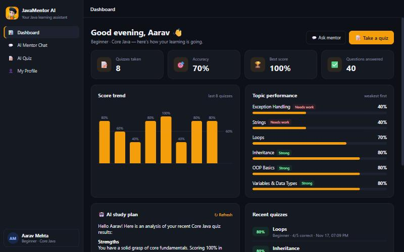
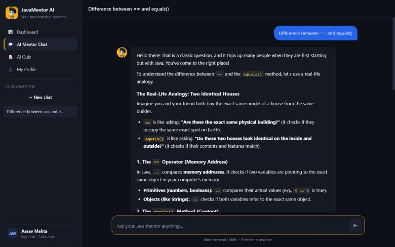
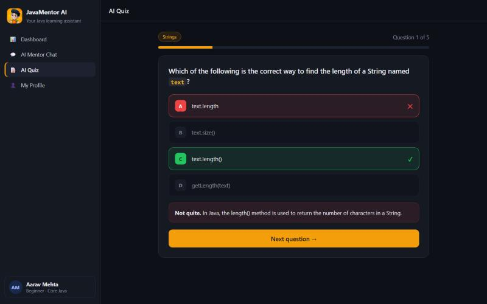
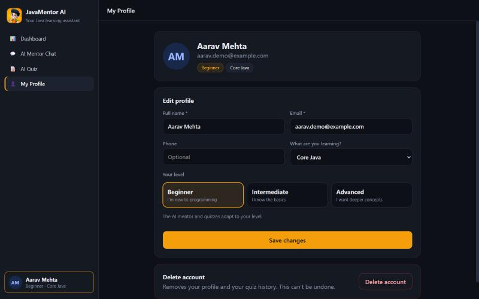
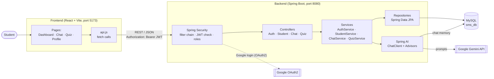
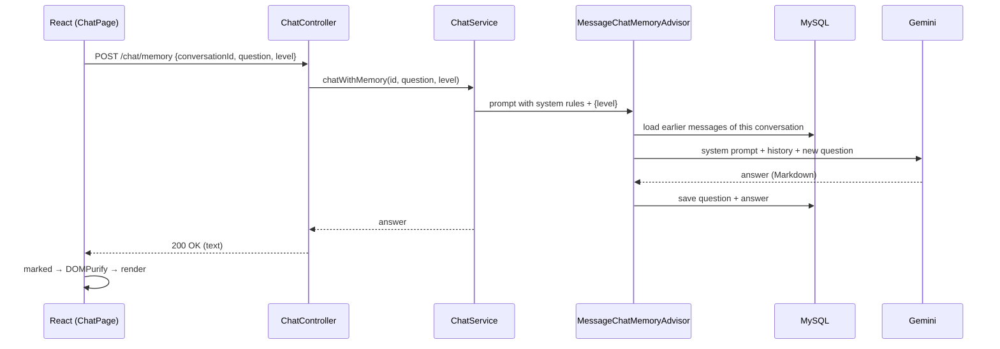
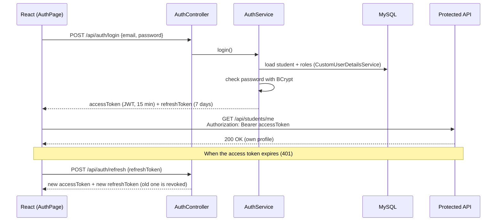
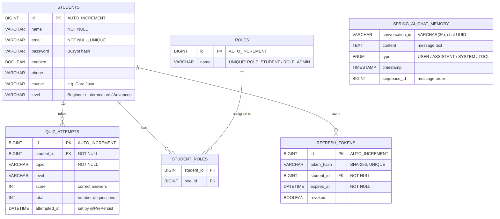

<div align="center">


# JavaMentor AI

**An AI-powered mentor for students learning Java from scratch.**
Chat with a patient AI tutor, practise with AI-generated quizzes, and track your progress on a personal dashboard.


</div>

---

## Table of contents

- [About the project](#about-the-project)
- [Features](#features)
- [Screenshots](#screenshots)
- [Tech stack](#tech-stack)
- [Project architecture](#project-architecture)
- [How the AI works](#how-the-ai-works)
- [Security (Spring Security)](#security-spring-security)
- [Database design](#database-design)
- [REST API](#rest-api)
- [Project structure](#project-structure)
- [Getting started](#getting-started)
- [Testing](#testing)
- [Future implementation](#future-implementation)

---

## About the project

Beginners learning Java get stuck on small doubts, don't know whether they really understood a topic, and have no idea what to study next.
**JavaMentor AI** solves this with three things in one place:

1. **An AI mentor** that explains concepts step by step, with real-life analogies, commented Java code and a small exercise. It adapts to the student's level.
2. **AI quizzes** on any Java topic, with instant feedback and explanations.
3. **A performance dashboard** that turns quiz results into accuracy, strong and weak topics, and an **AI-generated study plan**.

---

## Features

| Feature | Description |
|---|---|
| 🔐 **Register and login** | Sign up with email + password or with **Google (OAuth2)**. Spring Security issues a short-lived **JWT** access token and a **refresh token**, so students stay signed in safely |
| 🛡️ **Roles and protected data** | Every student is `ROLE_STUDENT` and can only see and change **their own** profile, quizzes and study plan. `ROLE_ADMIN` can manage any student |
| 👤 **Student profile** | View, update and delete your own profile (name, email, course, level). The level (Beginner / Intermediate / Advanced) personalises the AI |
| 💬 **AI Mentor Chat** | Multi-conversation chat with the Gemini model. Remembers earlier messages (memory stored in MySQL), renders Markdown and code, and has a copy button |
| 📝 **AI Quiz** | Pick from 14 topics or type your own. Choose level and number of questions; the AI writes fresh multiple-choice questions every time |
| ✅ **Instant feedback** | Correct and wrong answers are highlighted, with a short explanation per question and a full answer review at the end |
| 📊 **Performance dashboard** | Quizzes taken, accuracy, best score, questions answered, score trend chart, topic-wise performance (weakest first) |
| 🤖 **AI study plan** | The AI reads your quiz history and returns *Strengths / Needs work / Next steps* |
| 📱 **Responsive UI** | Works on desktop and mobile (collapsible sidebar) |

---

## Screenshots

| Log in (email + password or Google) | Register (create your account) |
|---|---|
|  |  |

| Dashboard (performance + AI study plan) | AI Mentor Chat |
|---|---|
|  |  |

| AI Quiz (instant feedback) | My Profile |
|---|---|
|  |  |

---

## Tech stack

| Layer | Technology |
|---|---|
| Language | Java 21 |
| Backend framework | Spring Boot 4.1 (Spring Web MVC) |
| AI | Spring AI 2.0 + Google Gemini (`gemini-3.5-flash-lite`) |
| Security | Spring Security: JWT resource server (HS256), OAuth2 client (Google login), BCrypt, method security (`@PreAuthorize`) |
| Validation | Jakarta Bean Validation (`@Valid`) + `@RestControllerAdvice` global error handler |
| Persistence | Spring Data JPA (Hibernate), MySQL 8 |
| Chat memory | Spring AI JDBC Chat Memory Repository (MySQL) |
| Frontend | React 18, Vite 5 |
| Markdown / security | marked, DOMPurify (XSS protection) |
| Build tools | Maven, npm |
| API testing | Postman |

---

## Project architecture

The backend follows a **layered architecture**: Controller → Service → Repository → Database.
The React app talks to the backend over REST. During development, Vite proxies `/api` and `/chat` to Spring Boot. Every request first passes through the **Spring Security filter chain**, which checks the JWT before any controller runs.



| Layer | Responsibility |
|---|---|
| **Security** | `SecurityConfig` filter chain: validates the JWT, maps its `roles` claim to authorities, blocks unauthenticated (`401`) and unauthorised (`403`) requests |
| **Controller** | HTTP only: maps URLs, reads the request body and the logged-in student from the JWT, sets status codes (201, 204) |
| **Service** | Business logic and all Spring AI code (prompts, memory, structured output, validation, retries) |
| **Repository** | Database access through Spring Data JPA; queries are derived from method names |
| **Entity / DTO** | Entities map tables; DTOs and records define request and response shapes (entities are never exposed directly) |

### Request flow: asking the AI mentor a question



---

## How the AI works

| Spring AI concept | Where it is used |
|---|---|
| **`ChatClient`** (fluent API) | All AI calls: `prompt().system().user().call()` |
| **System prompt** | Gives the AI the *JavaMentor* personality: step-by-step teaching, analogies, Java-only code, a "Try it yourself" exercise, staying on topic |
| **Prompt templates** | `{level}`, `{topic}` and `{count}` are filled at runtime, so the same prompt adapts to each student |
| **Chat memory + advisor** | `MessageChatMemoryAdvisor` with a JDBC repository, so each conversation's history is stored in MySQL and sent with follow-up questions |
| **Structured output** | `.entity(Quiz.class)` makes Gemini return JSON that maps straight onto Java records (`Quiz`, `Question`) |
| **Defensive AI handling** | Quiz output is **validated** (exactly 4 options, a valid `correctIndex`) and the call is **retried up to 3 times** if the model returns broken JSON |
| **AI analysis** | The study-plan endpoint turns quiz history into text and asks the model for strengths, weak areas and next steps |

> Official numbers (scores, accuracy, averages) are always **calculated in code**. The AI only explains and advises; it never decides the numbers.

---

## Security (Spring Security)

The app is secured with **Spring Security**. It is **stateless**: no server session is kept for normal API calls. Each request carries a **JWT access token** in the `Authorization: Bearer <token>` header.

### How login works



### What is implemented

| Concept | How it is done |
|---|---|
| **Password storage** | Passwords are hashed with **BCrypt** (`BCryptPasswordEncoder`), never stored as plain text |
| **Login** | `AuthenticationManager` + `DaoAuthenticationProvider` + `CustomUserDetailsService` (loads the student by email) |
| **JWT access token** | Signed with **HS256** using `JWT_SECRET` (`NimbusJwtEncoder`). Contains `sub` (email), `studentId`, `roles`, `iss` and expires after **15 minutes** |
| **JWT validation** | Spring's **OAuth2 Resource Server** checks the signature, expiry and issuer (`javamentor-ai`) on every request |
| **Refresh tokens** | Random 256-bit tokens, valid for **7 days**. Only their **SHA-256 hash** is stored in the `refresh_tokens` table. Each refresh **rotates** the token (the old one is revoked). If a revoked token is reused, **all** of that student's tokens are revoked (theft detection) |
| **Logout** | `POST /api/auth/logout` revokes the refresh token |
| **Google login (OAuth2)** | Spring Security **OAuth2 Client** with Google (`openid, profile, email`). Only **verified** Google emails are accepted. After login the backend redirects to the React app with its own JWT + refresh token. `?mode=register` creates a new account, otherwise it logs in to an existing one |
| **Roles** | `ROLE_STUDENT` (given on register) and `ROLE_ADMIN`. Both are created at startup by `RoleSeeder`; an admin account is created by `AdminSeeder` from `ADMIN_EMAIL` / `ADMIN_PASSWORD` |
| **Authorization rules** | `/api/auth/**` and the OAuth2 URLs are public. `/api/students/me` needs any logged-in user. Other `/api/students/**` endpoints need `ROLE_ADMIN` (URL rule **and** `@PreAuthorize`). Everything else needs a valid JWT |
| **Own data only** | Quiz and profile endpoints read the student id **from the JWT** (`CurrentUser.studentId(jwt)`), never from the URL, so one student can't read another student's data |
| **CORS** | Only the frontend origin (`http://localhost:5173`) is allowed, with the `Authorization` and `Content-Type` headers |
| **CSRF** | Disabled, because the API uses bearer tokens instead of cookies |
| **JSON errors** | `JsonSecurityErrorHandler` and `GlobalExceptionHandler` return clean JSON for `400`, `401`, `403`, `404` and `409` (e.g. duplicate email) |

---

## Database design

Database: **`sms_db`** (MySQL). Tables are created automatically: `students`, `quiz_attempts`, `roles`, `student_roles` and `refresh_tokens` by Hibernate (`ddl-auto=update`), and `SPRING_AI_CHAT_MEMORY` by Spring AI (`initialize-schema=always`).



| Table | Purpose | Notes |
|---|---|---|
| `students` | Student accounts and profiles | `email` is unique and is the login name. `password` is a BCrypt hash. `level` personalises AI answers and quizzes |
| `roles` / `student_roles` | Spring Security roles | `@ManyToMany` between students and roles (`ROLE_STUDENT`, `ROLE_ADMIN`) |
| `refresh_tokens` | Refresh tokens for staying logged in | Stores only a SHA-256 hash of the token, its expiry and whether it is revoked |
| `quiz_attempts` | One row per finished quiz | `@ManyToOne` → `students.id`. Deleting a student first deletes their attempts and refresh tokens, all inside one `@Transactional` method |
| `SPRING_AI_CHAT_MEMORY` | Conversation history for the AI | Managed by Spring AI. `conversation_id` = the chat's UUID created in the browser (36 chars). Indexed by `(conversation_id, timestamp)` and `(conversation_id, sequence_id)` |

**Design decisions**
- Percentages are **not stored**; they are calculated from `score / total` when needed, so the data can never contradict itself.
- The API returns **DTO records** (`AttemptResponse`) instead of the `QuizAttempt` entity, which avoids lazy-loading and serialization problems.
- `attempted_at` is set automatically in a `@PrePersist` callback, so clients can't fake the time.

---

## REST API

Base URL: `http://localhost:8080`

> 🔒 Except for `/api/auth/**` and the Google login URLs, **every endpoint needs a JWT**:
> `Authorization: Bearer <accessToken>`. Without it the API returns `401 Unauthorized`; with the wrong role it returns `403 Forbidden`.

### Authentication (public)

| Method | Endpoint | Description | Success |
|---|---|---|---|
| `POST` | `/api/auth/register` | Create an account (`ROLE_STUDENT`). Password must be 8 to 72 characters | `201 Created` (`409` if the email is taken) |
| `POST` | `/api/auth/login` | Log in with email + password, returns tokens | `200 OK` (`401` if wrong) |
| `POST` | `/api/auth/refresh` | Swap a refresh token for a new access + refresh token | `200 OK` |
| `POST` | `/api/auth/logout` | Revoke the refresh token | `204 No Content` |
| `GET` | `/oauth2/authorization/google` | Start Google login (add `?mode=register` to sign up). Redirects back to `http://localhost:5173/oauth2/callback` with the tokens | `302 Redirect` |

```json
// POST /api/auth/register
{ "name": "Rahul Sharma", "email": "rahul@example.com", "password": "secret123",
  "phone": "9876543210", "course": "Core Java", "level": "Beginner" }

// POST /api/auth/login  →  response
{ "accessToken": "eyJhbGciOiJIUzI1NiJ9...", "tokenType": "Bearer",
  "expiresIn": 900, "refreshToken": "q3Jx...Zk" }
```

### Student profile (logged-in student)

| Method | Endpoint | Description | Success |
|---|---|---|---|
| `GET` | `/api/students/me` | Get your own profile | `200 OK` |
| `PUT` | `/api/students/me` | Update your profile. Body: `{ "name": "...", "phone": "...", "course": "...", "level": "..." }` | `200 OK` |
| `DELETE` | `/api/students/me` | Delete your account, quiz history and tokens | `204 No Content` |

### Admin only (`ROLE_ADMIN`)

| Method | Endpoint | Description | Success |
|---|---|---|---|
| `PUT` | `/api/students/{id}` | Update any student's profile | `200 OK` (`404` if not found) |
| `DELETE` | `/api/students/{id}` | Delete any student and their data | `204 No Content` |

### AI Mentor Chat

| Method | Endpoint | Description |
|---|---|---|
| `POST` | `/chat/memory` | Ask the mentor; remembers the conversation. Body: `{ "conversationId": "<uuid>", "question": "...", "level": "Beginner" }`. Returns Markdown text |

### AI Quiz and performance

| Method | Endpoint | Description | Success |
|---|---|---|---|
| `POST` | `/api/quiz/generate` | Generate a quiz. Body: `{ "topic": "Loops", "level": "Beginner", "count": 5 }` | `200 OK` |
| `POST` | `/api/quiz/attempts` | Save a finished quiz for the logged-in student. Body: `{ "topic": "Loops", "level": "Beginner", "score": 4, "total": 5 }` | `201 Created` |
| `GET` | `/api/quiz/attempts` | Your quiz history, newest first (includes `percentage`) | `200 OK` |
| `GET` | `/api/quiz/tips` | AI study plan based on your quiz history (Markdown) | `200 OK` |

> The student id is taken from the JWT, not from the URL or body, so a student can only save and read their own attempts.

```json
// POST /api/quiz/generate  →  response
{
  "topic": "Loops",
  "questions": [
    {
      "question": "What does `for (int i = 0; i < 3; i++)` print if the body is `System.out.print(i);`?",
      "options": ["123", "012", "0123", "Nothing"],
      "correctIndex": 1,
      "explanation": "i starts at 0 and the loop stops before i reaches 3."
    }
  ]
}
```

### Learning endpoints (Spring AI basics)

Kept from the learning phase to show each Spring AI concept on its own:

| Method | Endpoint | Concept |
|---|---|---|
| `GET` | `/chat?question=` | Plain `ChatClient` call |
| `GET` | `/chat/system?question=` | System prompt |
| `GET` | `/chat/template?topic=&level=` | Prompt template |
| `GET` | `/chat/system/template?topic=&level=` | System prompt + template |
| `POST` | `/chat/post` | JSON body with a `Map` |
| `POST` | `/chat/structured` | Structured output → `ConceptExplanation` record |

---

## Project structure

```
java-mentor-ai/
├── pom.xml
├── src/main/java/com/example/javamentor/
│   ├── JavaMentorAiApplication.java      # Spring Boot entry point
│   ├── config/
│   │   ├── SecurityConfig.java           # filter chain, JWT encoder/decoder, BCrypt, CORS
│   │   ├── RoleSeeder.java               # creates ROLE_STUDENT and ROLE_ADMIN at startup
│   │   └── AdminSeeder.java              # creates the admin from ADMIN_EMAIL / ADMIN_PASSWORD
│   ├── security/                         # Spring Security building blocks
│   │   ├── JwtService.java               # issues signed access tokens
│   │   ├── RefreshTokenService.java      # create, rotate and revoke refresh tokens
│   │   ├── CustomUserDetailsService.java # loads a student by email for login
│   │   ├── StudentPrincipal.java         # UserDetails wrapper around Student
│   │   ├── CurrentUser.java              # reads studentId from the JWT
│   │   ├── OAuth2LoginHandler.java       # Google login success/failure → redirect with tokens
│   │   ├── OAuth2ModeRequestResolver.java# remembers login vs register mode
│   │   └── JsonSecurityErrorHandler.java # JSON 401 / 403 responses
│   ├── controller/                       # REST endpoints (HTTP only)
│   │   ├── AuthController.java           # register, login, refresh, logout
│   │   ├── StudentController.java
│   │   ├── ChatController.java
│   │   └── QuizController.java
│   ├── service/                          # business logic + Spring AI
│   │   ├── AuthService.java              # register, password + Google login, token issuing
│   │   ├── StudentService.java
│   │   ├── ChatService.java              # mentor prompt, chat memory
│   │   └── QuizService.java              # quiz generation, validation, retry, study tips
│   ├── repository/                       # Spring Data JPA
│   │   ├── StudentRepository.java
│   │   ├── QuizAttemptRepository.java
│   │   ├── RoleRepository.java
│   │   └── RefreshTokenRepository.java
│   ├── entity/                           # JPA entities
│   │   ├── Student.java
│   │   ├── QuizAttempt.java
│   │   ├── Role.java
│   │   └── RefreshToken.java
│   ├── dto/                              # request/response records
│   │   ├── RegisterRequest.java / RegisterResponse.java
│   │   ├── LoginRequest.java / LoginResponse.java / RefreshRequest.java
│   │   ├── StudentResponse.java / UpdateProfileRequest.java
│   │   ├── ApiError.java
│   │   ├── ChatRequest.java
│   │   ├── Quiz.java
│   │   ├── QuizDtos.java
│   │   └── ConceptExplanation.java
│   └── exception/
│       ├── GlobalExceptionHandler.java   # @RestControllerAdvice → 400 / 401 / 403 / 404 / 409
│       ├── StudentNotFoundException.java # → 404
│       ├── EmailAlreadyRegisteredException.java # → 409
│       ├── AccountNotRegisteredException.java
│       └── InvalidRefreshTokenException.java    # → 401
├── src/main/resources/application.properties
├── frontend/                             # React app (Vite)
│   ├── public/logo.png
│   ├── vite.config.js                    # proxies /api and /chat → :8080
│   └── src/
│       ├── App.jsx                       # app shell, page routing (#hash)
│       ├── api.js                        # every backend call; adds the JWT, auto-refreshes on 401
│       ├── hooks/useChats.js             # chat list per student
│       ├── components/                   # Sidebar, Message, Markdown, Logo
│       └── pages/                        # AuthPage (login/register), Dashboard, ChatPage, QuizPage, ProfilePage
└── docs/screenshots/
```

---

## Getting started

### Prerequisites

- **JDK 21+**
- **MySQL 8** running on `localhost:3306` (the database `sms_db` is created automatically)
- **Node.js 18+** and npm
- A **Google Gemini API key**, free from [Google AI Studio](https://aistudio.google.com/apikey)

### 1. Configure environment variables

Secrets are **never** stored in the code. Set these before starting the backend (in Eclipse: *Run Configurations → Environment*):

| Variable | Example | Required |
|---|---|---|
| `Gemini_API_KEY` | `your-gemini-key` | ✅ |
| `DB_PASSWORD` | `your-mysql-password` | ✅ |
| `DB_USERNAME` | `root` (default) | optional |
| `JWT_SECRET` | Base64 string of at least 32 random bytes | ✅ |
| `GOOGLE_CLIENT_ID` | from Google Cloud Console | ✅ |
| `GOOGLE_CLIENT_SECRET` | from Google Cloud Console | ✅ |
| `ADMIN_EMAIL` | `admin@example.com` | optional (creates an admin on startup) |
| `ADMIN_PASSWORD` | a strong password | optional |

**Generate a `JWT_SECRET`** (the app refuses to start if it is shorter than 32 bytes):

```bash
openssl rand -base64 32
```

**Set up Google login:** in [Google Cloud Console](https://console.cloud.google.com/apis/credentials) create an *OAuth client ID* (type *Web application*) and add this **Authorised redirect URI**:

```
http://localhost:8080/login/oauth2/code/google
```

### 2. Run the backend

```bash
./mvnw spring-boot:run
```

On Windows use `mvnw.cmd spring-boot:run`, or in Eclipse: *Run As → Spring Boot App*. The backend starts on **http://localhost:8080**.

### 3. Run the frontend

```bash
cd frontend
npm install
npm run dev
```

Open **http://localhost:5173**, register (or continue with Google) and start learning.

---

## Testing

All REST endpoints were tested manually with **Postman**, covering success and error cases:

| Scenario | Expected |
|---|---|
| Create a profile | `201 Created` with the generated `id` |
| Get / update a profile | `200 OK` |
| Delete a profile | `204 No Content` (quiz history deleted too) |
| Get a deleted or unknown id | `404 Not Found` |
| Follow-up question in the same conversation | AI remembers the earlier question |
| New `conversationId` | AI starts a fresh conversation |
| Generate a quiz | Valid questions with exactly 4 options |

The full flow (create profile → quiz → dashboard → edit → delete) was also tested end to end in the browser.

---

## Future implementation

| Planned | Why |
|---|---|
| 🗂️ **Chats saved per student on the server** | Conversations follow the student to any device (currently the chat list is kept in the browser) |
| 🍪 **HttpOnly cookie for the refresh token** | Keep the refresh token out of `localStorage` to reduce XSS risk |
| 🧑‍💼 **Admin dashboard** | A UI for `ROLE_ADMIN` to list, edit and disable students |
| ⚡ **Streaming answers** | Show the AI's answer word by word (`.stream()` + Server-Sent Events) |
| 📚 **RAG (Retrieval-Augmented Generation)** | Upload Java notes or PDFs into a vector store so the mentor answers from course material |
| 🛠️ **Tool calling** | Let the AI call backend methods ("show my weak topics") using real student data |
| 🧪 **Automated tests** | JUnit 5 + MockMvc tests for every endpoint, with the AI mocked |
| 🏅 **Gamification** | Daily streaks, badges and a learning roadmap per level |
| 🐳 **Docker + cloud deployment** | `docker-compose` for app + MySQL; deploy the backend (Render / Railway) and frontend (Vercel) |

---

<div align="center">

Built with ☕ Java, 🌱 Spring AI, 🔐 Spring Security and ⚛️ React

</div>
